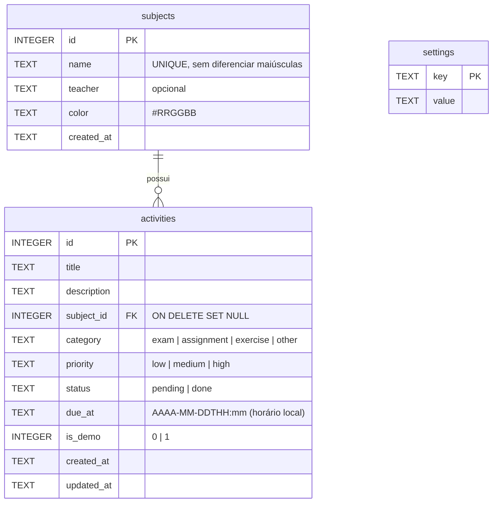

# CampusFlow

Aplicativo mobile de organização acadêmica: reúne tarefas, provas, trabalhos, disciplinas e prazos em uma interface simples, com dados salvos localmente em SQLite e lembretes por notificação local.

Desenvolvido com **React Native + Expo SDK 58 + TypeScript**, compatível com o **Expo Go** (Android e iOS).

---

## 1. Nome e descrição

**CampusFlow** é um organizador para a vida universitária. O estudante cadastra suas disciplinas (com professor e cor) e as atividades de cada uma: provas, trabalhos, exercícios e outros compromissos, com prazo (data e horário), prioridade e status. O app mostra o que está atrasado, o que vence em breve, um calendário mensal, estatísticas de desempenho e envia lembretes antes dos prazos.

## 2. Problema que resolve

As atividades acadêmicas costumam ficar espalhadas entre anotações, grupos de mensagens, calendários e diferentes plataformas das disciplinas. Isso dificulta enxergar prazos próximos e faz com que entregas sejam esquecidas. O CampusFlow centraliza tudo em um único lugar, no celular, funcionando sem internet.

## 3. Público-alvo

Estudantes universitários que querem organizar a rotina acadêmica pelo celular, especialmente quem cursa várias disciplinas ao mesmo tempo e precisa acompanhar muitas entregas.

## 4. Objetivos e justificativa

- **Centralizar** atividades e disciplinas em um único aplicativo.
- **Dar visibilidade** ao que está atrasado e ao que vence nos próximos dias.
- **Lembrar** o estudante antes dos prazos, com notificações locais configuráveis.
- **Mostrar o progresso** com indicadores calculados a partir dos dados reais.
- **Funcionar offline**: os dados ficam no próprio aparelho (SQLite), sem depender de servidor ou conta.

A escolha por um app mobile se justifica porque o celular é o dispositivo que o estudante tem sempre à mão; a persistência local garante privacidade e uso sem conexão.

## 5. Tecnologias utilizadas

| Tecnologia | Versão | Uso no projeto |
| --- | --- | --- |
| Expo SDK | 58.0.21 | Plataforma de desenvolvimento e execução no Expo Go |
| React Native | 0.88.1 | Interface nativa (New Architecture) |
| React | 19.3.0 | Componentes e hooks |
| TypeScript | 6.0.3 | Tipagem estática (modo `strict`) |
| Expo Router | 58.0.28 | Navegação baseada em arquivos (abas + pilha) e rotas tipadas |
| expo-sqlite | 58.0.14 | Banco de dados local (fonte principal dos dados) |
| expo-notifications | 58.1.7 | Lembretes por notificação local |
| @react-native-community/datetimepicker | 9.2.1 | Seletor nativo de data e hora |
| @expo/vector-icons (Ionicons) | 15.1.1 | Ícones |
| react-native-safe-area-context | 5.10.1 | Área segura (entalhe, barra de gestos) |
| ESLint + eslint-config-expo | 9.39 / 58.0.4 | Análise estática |
| node:test + tsx | Node ≥ 22.13 / 4.23 | Testes automatizados da camada de dados |

Todas as bibliotecas nativas usadas estão **incluídas no Expo Go do SDK 58** (verificado na documentação oficial). Nenhuma exige *development build*.

## 6. Arquitetura resumida

```
src/
├── app/                  Rotas do Expo Router (cada arquivo é uma tela)
│   ├── _layout.tsx         Raiz: SQLiteProvider + navegação em pilha + toast
│   ├── (tabs)/             Barra de abas inferior
│   │   ├── _layout.tsx       Definição das 5 abas
│   │   ├── index.tsx         Tela 1 – Início (dashboard)
│   │   ├── activities.tsx    Tela 2 – Atividades
│   │   ├── calendar.tsx      Tela 4 – Calendário
│   │   ├── subjects.tsx      Tela 5 – Disciplinas
│   │   └── stats.tsx         Tela 6 – Estatísticas
│   ├── activity/
│   │   ├── form.tsx          Tela 3 – Criar/editar atividade
│   │   └── [id].tsx          Detalhes da atividade
│   ├── subject/form.tsx    Criar/editar disciplina
│   └── settings.tsx        Tela 7 – Configurações
├── components/           Componentes reutilizáveis (cartão de atividade, chips,
│                         campos de formulário, indicadores, estados vazios, toast…)
├── constants/            Tema (cores, espaçamentos, tipografia) e opções
├── database/             Esquema/migração, dados de demonstração, aviso de mudanças
├── repositories/         Todo o SQL do app (consultas parametrizadas)
├── services/             Ações de gravação (regras + lembretes) e notificações
├── hooks/                useQuery: consulta ao banco + recarga automática
├── types/                Modelos TypeScript
└── utils/                Datas, formatação e validação
tests/                    Testes automatizados (SQL real com node:sqlite)
```

Com o Expo Router, as pastas `screens/` e `navigation/` sugeridas no enunciado correspondem a `src/app/`: o nome do arquivo define a rota, e os arquivos `_layout.tsx` definem os navegadores.

**Fluxo de dados (separação de responsabilidades):**

```
Tela ──lê──▶ hooks/useQuery ──▶ repositories (SQL) ──▶ SQLite
  │                 ▲
  └─grava─▶ services/actions ──▶ repositories ──▶ SQLite
                    ├──▶ services/notifications (agenda/cancela lembretes)
                    └──▶ database/changes.notifyDataChanged() ──▶ telas recarregam
```

- **Telas** só apresentam dados e tratam interação; não contêm SQL.
- **Repositórios** concentram todas as consultas, sempre com parâmetros (`?`).
- **Serviços** aplicam as regras de negócio de cada gravação: salvar, reagendar o lembrete e avisar as telas.
- **useQuery** executa consultas e repete-as quando o banco muda, por isso todas as telas abertas ficam atualizadas.

## 7. Telas e funcionalidades

| # | Tela | Funcionalidades |
| --- | --- | --- |
| 1 | **Início** | Saudação por horário (com o nome do usuário), data, progresso geral (% concluído), contadores de pendentes/concluídas/atrasadas (tocáveis), prazos nos próximos 7 dias, seção de **atrasadas em destaque vermelho**, próximos prazos, atalhos para as demais seções, botão flutuante "Nova atividade" e boas-vindas com carga de exemplo quando o banco está vazio. |
| 2 | **Atividades** | Lista completa com filtros por **status** (pendentes, atrasadas, concluídas), **prioridade** e **disciplina** (inclui "Sem disciplina"), **ordenação por prazo** crescente/decrescente, atrasadas destacadas, concluir/reabrir pelo círculo do cartão, menu ⋯ (editar/excluir), toque para ver detalhes, estado vazio com botão para criar a primeira atividade. |
| 3 | **Criar/Editar atividade** | Um único formulário reutilizado: título, descrição, disciplina (com atalho para criar uma nova), categoria (prova, trabalho, exercício, outro), data e horário do prazo (seletor nativo + atalhos Hoje/Amanhã/Em 1 semana), prioridade e status. Validação com mensagens no próprio campo, aviso de prazo já vencido e confirmação ao salvar (com o horário do lembrete agendado). |
| 4 | **Calendário** | Grade mensal feita com componentes nativos, dias com compromissos destacados, pontos coloridos por categoria (provas e trabalhos identificados) e ponto vermelho para atrasos, legenda, navegação entre meses, botão "Hoje", lista das atividades do dia selecionado e "Adicionar neste dia". |
| 5 | **Disciplinas** | Cadastro, edição e exclusão; nome, professor(a) opcional e cor identificadora (paleta de 10 cores); quantidade de atividades e pendentes; toque abre as atividades da disciplina. A exclusão trata as referências: o usuário escolhe **manter as atividades sem disciplina** ou **excluí-las junto**. |
| 6 | **Estatísticas** | Total, concluídas, pendentes, atrasadas, taxa de conclusão, prazos em 7 dias, resumo **por disciplina** (concluídas/total, % e atrasadas) e **por categoria** (quantidade e participação). Tudo calculado por consultas `COUNT`/`SUM` no SQLite. |
| 7 | **Configurações** | Nome do usuário, ativar/desativar lembretes, antecedência (no horário, 1 h, 1 dia, 2 dias), estado da permissão, notificação de teste, carregar dados de demonstração, apagar todos os dados (com confirmação explícita), informações de armazenamento (arquivo, versão do SQLite, contagens) e sobre o app. |
| + | **Detalhes da atividade** | Todos os campos, prazo por extenso e relativo, ações de concluir/reabrir, editar e excluir, datas de criação e atualização. |
| + | **Criar/Editar disciplina** | Formulário com validação de nome único (sem diferenciar maiúsculas/minúsculas). |

**Identidade visual:** azul profundo (`#1B3B8C` / `#132A66`) como cor principal, verde-limão (`#C8F05A`) como destaque usado com moderação (progresso), fundo claro com superfícies brancas, cantos arredondados e sombras discretas, ícones Ionicons em todo o app, feedback por *toast* e cores semânticas (vermelho = atrasado, âmbar = vence em breve, verde = concluído). O ícone do app foi criado para o projeto.

**Acessibilidade:** rótulos para leitores de tela em botões de ícone, cartões e abas; estados (selecionado, marcado, ocupado) informados; ações extras dos cartões expostas como ações de acessibilidade; áreas de toque de pelo menos 44 pt; contraste adequado; texto escalável; área segura respeitada; campos de texto no topo dos formulários para não serem cobertos pelo teclado.

## 8. Modelo do banco de dados

Banco `campusflow.db` (SQLite), criado e migrado automaticamente na abertura do app (`src/database/schema.ts`). A criação é idempotente (`CREATE TABLE IF NOT EXISTS`) e versionada com `PRAGMA user_version`. As chaves estrangeiras são ativadas em toda abertura (`PRAGMA foreign_keys = ON`).



**Restrições no próprio banco:** `NOT NULL`, `CHECK` de domínio (categoria, prioridade, status, formato da data e da cor, tamanho dos textos), nome de disciplina `UNIQUE COLLATE NOCASE`, chave estrangeira com `ON DELETE SET NULL` e índices em `due_at` e `subject_id`.

**Decisões:**
- O prazo é gravado como texto em **horário local** (`2026-11-05T19:00`). Esse formato ordena corretamente como texto, permite comparar com "agora" no próprio SQL (atrasadas) e não muda de dia por conversão de fuso.
- "Atrasada" não é gravada: é calculada (`status = 'pending' AND due_at < agora`), por isso nunca fica desatualizada.
- `is_demo` marca só as atividades de demonstração, para recriá-las sem tocar nos dados do usuário.
- `settings` guarda as preferências (nome, lembretes, antecedência) no mesmo banco.

## 9. Instalação e execução

**Pré-requisitos**
- Node.js **22.13+**, 24.3+ ou 26 (exigência do Expo SDK 58) e npm.
- Celular com o app **Expo Go** atualizado (SDK 58), na mesma rede Wi-Fi do computador.

**Passos**

```bash
npm install          # instala as dependências (versões travadas no package-lock.json)
npx expo start       # inicia o servidor de desenvolvimento e mostra o QR code
```

Scripts úteis:

```bash
npm test             # testes automatizados (SQL real em SQLite + utilitários)
npm run typecheck    # verificação de tipos (tsc --noEmit)
npm run lint         # ESLint (configuração oficial do Expo)
npx expo-doctor      # diagnóstico de dependências e configuração
```

## 10. Como abrir no Expo Go

1. Instale o **Expo Go** pela Play Store (Android) ou App Store (iOS) e confirme que está atualizado.
2. Conecte o celular e o computador à **mesma rede Wi-Fi**.
3. No computador, execute `npx expo start`.
4. **Android:** abra o Expo Go e toque em *Scan QR code*. **iOS:** aponte a câmera para o QR code e toque no link para abrir no Expo Go.
5. Na primeira abertura o banco é criado automaticamente. Para demonstrar, toque em **"Explorar com dados de exemplo"** na tela inicial.

Se a rede bloquear a conexão direta (Wi-Fi de universidade costuma isolar os aparelhos), use o modo túnel: `npx expo start --tunnel`. No SDK 58 ele usa o túnel do próprio Expo, que funciona mesmo com celular e computador em redes diferentes.

## 11. Permissões e limitações

**Notificações (lembretes)**
- A permissão só é pedida quando o usuário **ativa os lembretes** ou envia a **notificação de teste** nas Configurações. Se for negada, o app continua funcionando sem lembretes, mostra o estado da permissão e oferece atalho para os ajustes do sistema.
- O CampusFlow usa apenas **notificações locais**, que funcionam no Expo Go. O Expo Go não oferece *push* remoto no Android desde o SDK 53; o app não usa push, e o aviso que o Expo Go exibe sobre isso foi silenciado na interface (continua aparecendo no terminal).
- No Expo Go, a permissão de notificação pertence ao **app Expo Go**, não ao CampusFlow. Em um build próprio, ela seria do próprio app.
- Lembretes só são agendados para atividades **pendentes** cujo horário de lembrete ainda está no futuro; são cancelados ao concluir ou excluir e reagendados ao editar ou mudar a antecedência.
- O iOS mantém no máximo 64 notificações locais por app; ao reagendar em lote, o CampusFlow agenda as 60 mais próximas.
- No Android, sem a permissão de alarme exato, o sistema pode atrasar a entrega em alguns minutos para economizar bateria (comportamento documentado do `expo-notifications`).

**Armazenamento**
- Os dados ficam **somente no aparelho**. Desinstalar o app (ou limpar os dados do Expo Go) apaga o banco. Não há sincronização nem backup em nuvem.

**Plataformas**
- O alvo é Android e iOS via Expo Go. A versão web não faz parte do escopo (o SQLite na web exige configuração extra e os seletores nativos de data não existem no navegador).

## 12. Dados de demonstração

Há dois caminhos:
- **Banco vazio:** na tela Início, toque em **"Explorar com dados de exemplo"**.
- **A qualquer momento:** Configurações → **"Carregar dados de demonstração"** (pede confirmação).

São criadas 5 disciplinas fictícias e 15 atividades com datas **relativas ao dia da carga**: 2 atrasadas, 1 para hoje, várias nos próximos dias e 5 concluídas.

A carga é controlada e **não duplica nem apaga dados do usuário**:
- disciplinas com o mesmo nome são reaproveitadas, sem duplicação;
- só as atividades marcadas como demonstração (`is_demo = 1`) são recriadas, então executar de novo apenas atualiza as datas;
- tudo acontece em uma transação.

Dica para a apresentação: recarregue os dados de demonstração no dia, para que as datas fiquem atuais.

## 13. Estratégia de testes e resultados

Detalhes completos em [docs/TESTES.md](docs/TESTES.md). Resumo do que **foi executado** em 29/10/2026:

| Verificação | Resultado |
| --- | --- |
| `npm test`: 15 testes da camada de dados e utilitários, com SQL real (node:sqlite) | 15/15 aprovados, repetidos em 6 fusos horários |
| `npm run typecheck` (TypeScript strict + rotas tipadas) | 0 erros; rota inexistente é rejeitada na compilação |
| `npm run lint` | 0 problemas |
| `npx expo-doctor` | 20/20 verificações |
| `npx expo export` (Android e iOS, bytecode Hermes) | Bundles gerados sem erros |
| `npx expo start` (manifesto e bundle que o Expo Go baixa) | Servidor ok, bundle Android com 1442 módulos |
| Teste de interface automatizado no navegador (cópia temporária com react-native-web) | 52/52 verificações dos fluxos principais |

**Ainda não testado em aparelho físico:** não havia celular nem emulador disponível no ambiente de desenvolvimento. Seletores nativos de data, notificações reais, teclado, área segura e leitores de tela precisam ser conferidos no Expo Go; o roteiro está em [docs/TESTES.md](docs/TESTES.md#5-pendente-teste-no-celular-com-expo-go).

## 14. Sugestão de divisão da apresentação (até 5 integrantes)

| Integrante | Parte | Tempo |
| --- | --- | --- |
| 1 | Problema, público-alvo, proposta e identidade visual | ~1 min |
| 2 | Demonstração: Início, Atividades (filtros e ordenação) e Calendário | ~1min30 |
| 3 | Demonstração do CRUD: criar com validação, editar, concluir, excluir; persistência ao reabrir | ~1min30 |
| 4 | Disciplinas (exclusão com vínculos), Estatísticas e Configurações (lembretes e notificação de teste) | ~1min30 |
| 5 | Arquitetura, banco SQLite, decisões técnicas, testes e limitações | ~1min30 |

O roteiro completo, com falas e perguntas prováveis do professor, está em [docs/APRESENTACAO.md](docs/APRESENTACAO.md).

---

## Repositório

Código-fonte: <https://github.com/GabrielRSSSC/campusflow>

```bash
git clone https://github.com/GabrielRSSSC/campusflow.git
cd campusflow
npm install
npx expo start
```

O `.gitignore` deixa de fora as dependências (`node_modules/`), os arquivos gerados pelo Expo (`.expo/`), as pastas nativas, builds, credenciais de assinatura, variáveis de ambiente, logs e configurações locais de editores.
